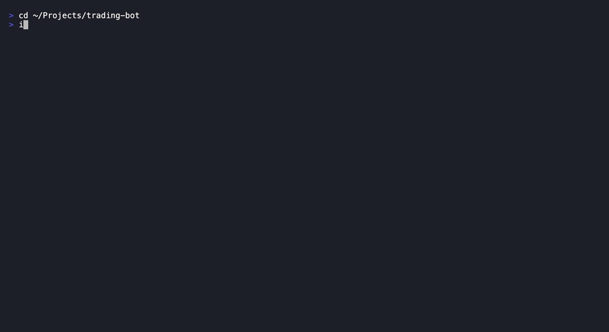

# importlens-mcp

[](https://pypi.org/project/importlens-mcp/)
[](https://github.com/Matheos13/importlens-mcp/blob/main/LICENSE)
[](https://github.com/Matheos13/importlens-mcp/actions/workflows/tests.yml)

**Give your coding agent the right slice of a Python repo in one call.**

importlens-mcp is a tiny [MCP](https://modelcontextprotocol.io) server that reads your Python project's *import graph* and hands your agent only the slice of code relevant to what it's working on — the file that defines a symbol, the files that use it, and the files it depends on. No embeddings, no vector DB, no re-reading the tree on every question.

> **Why:** when an agent needs to understand or change a symbol, it needs the defining file, the call sites that use it, and the interfaces of its dependencies — not the whole repo. importlens-mcp answers *"which files matter for `RiskManager`?"* in one call, returning exactly that slice using nothing but Python's own `ast`.



---

## Install

```bash
# run straight from PyPI with uv — no install needed
uvx importlens-mcp@latest

# or pip
pip install importlens-mcp
```

Add it to your agent. For **Claude Code** (user-wide):

```bash
claude mcp add --scope user importlens-mcp -- uvx importlens-mcp@latest
```

For any MCP client, point it at the `importlens-mcp` command (stdio transport). It indexes the current working directory by default, or set `IMPORTLENS_ROOT`.

## What your agent gets

Four tools, all returning plain readable text:

| tool | what it does |
|------|--------------|
| `project_map` | one-glance summary: files, modules, symbols, line count |
| `relevant_files(symbol)` | the files that define a symbol + its dependents + its dependencies |
| `file_context(path)` | one file's source plus the paths of its local imports |
| `reindex` | rebuild after you change files on disk |

### Example

Ask your agent *"how does `CodeIndex` fit together?"* and under the hood it calls:

```
relevant_files("CodeIndex")
```

```
# Relevant files for `CodeIndex`

## Defined in
- src/importlens_mcp/graph.py

## Used by (dependents)

### src/importlens_mcp/__main__.py
```python
   1  from importlens_mcp.graph import CodeIndex, call_sites
...
  22      idx = CodeIndex(str(root)).build()
  23      s   = idx.stats()
  24      ...
```

### src/importlens_mcp/server.py
```python
   1  from .graph import CodeIndex, call_sites
...
  34      _index = CodeIndex(_ROOT).build()
```

## Depends on (local imports)
- (none)
```

Dependents show only the lines that use the symbol (+ a few lines of context), not the whole file. Pass `include_full_dependents=True` to get file paths instead.

Look up a method with `ClassName.method_name` or `method_name`. A bare name can match definitions in multiple files.

## Quick look without an agent

```bash
importlens-mcp map .
importlens-mcp relevant RiskManager
```

```
importlens-mcp: 6 files, 6 modules, 51 symbols, 1021 lines
  importlens_mcp                           src/importlens_mcp/__init__.py
  importlens_mcp.__main__                  src/importlens_mcp/__main__.py
  importlens_mcp.graph                     src/importlens_mcp/graph.py
  importlens_mcp.server                    src/importlens_mcp/server.py
  ...
```

## How it works

1. Walk the repo, skipping the usual noise (`.venv`, `node_modules`, `__pycache__`, …).
2. Parse each `.py` file with the standard-library `ast` module — top-level functions and classes and their methods become *symbols*, `import` statements become *edges*.
3. Build two maps: `symbol -> files that define it` and `module -> files that import it`.
4. Answer queries by walking those maps. No network, no model calls, runs in milliseconds.

Import resolution is best-effort and handles `src/` layouts and relative imports. It won't catch dynamic imports or runtime magic — and that's a fine tradeoff for a v0.

## Benchmark

Four strategies compared on two real repos. Token estimate: `len(source) // 4`.

- **all files** — every source `.py` file (worst-case baseline)
- **grep full files** — files whose text contains the symbol name, plus their direct local imports, all read in full (naive agent behaviour)
- **grep -C3** — fairer smart-grep baseline: defining file read in full, every other mentioning file as a 3-line-context snippet
- **importlens** — what `relevant_files()` returns: defining file in full, local imports as signatures (def/class lines + first docstring line, no bodies), dependent files as call-site snippets

| repo | symbol | all files | grep full files | grep -C3 | importlens | % saved vs grep -C3 |
|------|--------|----------:|----------------:|---------:|-----------:|--------------------:|
| trading-bot | `RiskManager` | 7,504 | 7,201 | 911 | 839 | +8% |
| trading-bot | `TradingBot` | 7,504 | 7,201 | 1,138 | 1,675 | −47% |
| trading-bot | `BacktestEngine` | 7,504 | 7,201 | 1,557 | 1,930 | −24% |
| httpx | `DigestAuth` | 71,089 | 53,965 | 3,017 | 6,706 | −122% |
| httpx | `Timeout` | 71,089 | 61,102 | 3,045 | 6,256 | −105% |
| httpx | `MultipartStream` | 71,089 | 9,436 | 2,603 | 2,952 | −13% |
| httpx | `Client` | 71,089 | 65,077 | 17,514 | 24,190 | −38% |
| httpx | `Request` | 71,089 | 66,452 | 16,113 | 18,729 | −16% |

**Honest take:** switching local imports from full files to signatures (v0.3) cut the gap dramatically — `MultipartStream` went from −108% to −13%, `Request` from −110% to −16%, and the trading-bot symbols are now within striking distance of grep -C3. Importlens still costs more tokens on most symbols because it insists on the full defining file while grep -C3 only shows snippets of it too.

That tradeoff is intentional: signatures give your agent the full interface of every dependency (what methods exist, what they accept, what they return) without the implementation noise. Grep -C3 gives you fragments — enough to locate something, not enough to safely change it. `RiskManager` wins outright; `MultipartStream` and `Request` are essentially ties. The remaining gap on `DigestAuth` and `Timeout` comes from their defining files having large local import chains that contribute substantial signatures.

Rerun with `python benchmarks/bench.py` (httpx needs `git clone --depth=1 https://github.com/encode/httpx /tmp/httpx` first).

## Roadmap

- [ ] call-graph edges (who calls this function), not just imports
- [ ] respect `.gitignore`
- [x] method-level symbols
- [ ] `tree-sitter` backend for speed on huge repos

## Contributing

It's ~530 lines of plain Python. Read it, break it, send a PR. Good first issues are labeled.

<!-- BENCH:START -->
## Agent Benchmark

24 total runs (quick: 3 tasks × with/without = 6; full: 6 tasks × with/without × 2 = 24).  

### Per-task results

| cat | task | description | with pass | w/o pass | Δ pass | with tokens | w/o tokens | with tools | w/o tools | with tok/pass | w/o tok/pass | % fetched body |
|-----|------|-------------|-----------|----------|--------|-------------|------------|------------|-----------|---------------|--------------|----------------|
| A | `a1_commission` | add commission_pct to RiskManager | 100% | 100% | 0 | 71,192 | 70,947 | 3 | 3 | 71,192 | 70,947 | — |
| A | `a2_trailing_stop` | add trailing_stop_pct to RiskManager | 100% | 100% | 0 | 89,588 | 109,098 | 4 | 5 | 89,588 | 109,098 | — |
| B | `b1_fill_ts` | timestamp every PaperBroker fill | 100% | 100% | 0 | 185,512 | 227,404 | 12.5 | 11 | 185,512 | 227,404 | — |
| B | `b2_max_trades` | max_trades cap on BacktestEngine | 100% | 100% | 0 | 227,374 | 180,585 | 22.5 | 17.5 | 227,374 | 180,585 | — |
| C | `c1_stop_low` | stop-loss on candle.low + fill at stop price | 100% | 100% | 0 | 103,717 | 117,106 | 5 | 4.5 | 103,717 | 117,106 | 50% |
| C | `c2_warmup` | warmup period in run_sweep | 100% | 100% | 0 | 283,694 | 295,788 | 12.5 | 15.5 | 283,694 | 295,788 | 100% |
| — | **TOTAL** | — | 12/12 | 12/12 | — | 961,076 (-4%) | 1,000,926 | — | — | — | — | — |

### Category summary

| category | with pass% | w/o pass% | with tokens (med) | w/o tokens (med) | % fetched body (C only) |
|----------|-----------|----------|-------------------|-----------------|------------------------|
| A – defining file | 100% | 100% | 80,390 | 90,022 | — |
| B – call sites | 100% | 100% | 206,442 | 203,994 | — |
| C – dep body | 100% | 100% | 193,706 | 206,446 | 75% |

> **tok/pass** = total tokens across all runs ÷ number of passing runs (lower is better; ∞ if no run passed).  **% fetched body** = fraction of *with-importlens* runs on category-C tasks where the agent called `file_context` or `Read` on the tracked dependency.

> **Note:** small repo (~1.4k source lines), 2 runs per condition — differences under ~10% are within run-to-run noise. Token counts include cached input.
<!-- BENCH:END -->

## License

MIT
